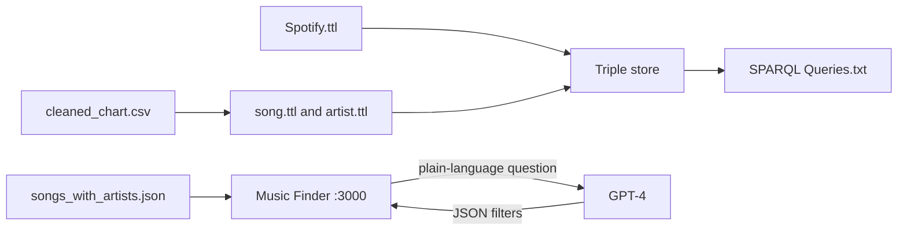
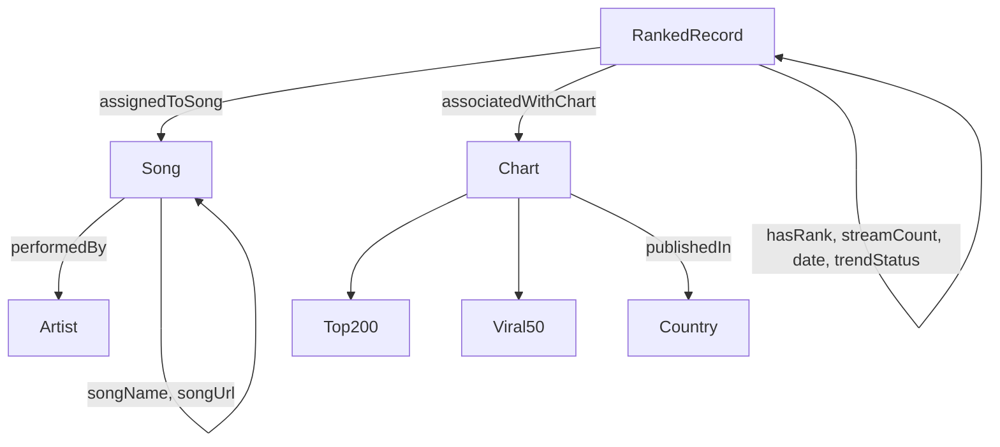
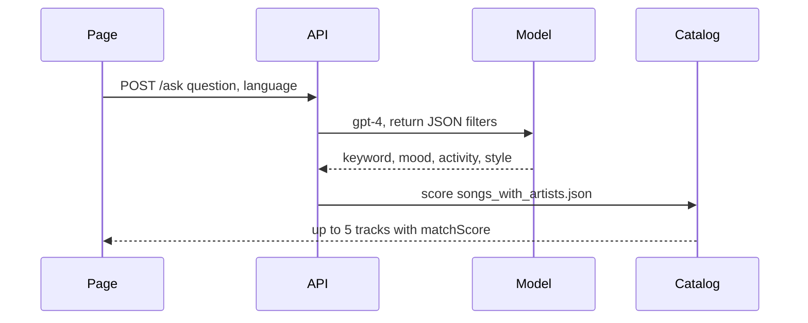

# Spotify Chart Graph

Spotify Chart Graph is a study knowledge graph of Spotify’s global charts, with a small search page on top. Chart rows become RDF. An OWL ontology names the songs, artists, ranks, and countries. SPARQL answers questions about the graph. Music Finder answers a plain-language question from a local song catalog.

It is a reference you can read, load, and explain. It is not a production music service, and Music Finder does not query the graph.

## What a visitor can try

Two separate paths. The graph is for SPARQL. The page is for everyday questions.

| Try this | Where | What you get |
| --- | --- | --- |
| Import the Turtle files and run query 3 | GraphDB | Songs that held number one on the Top 200 most often |
| Run query 10 | GraphDB | The ten countries with the most streams |
| “calm acoustic songs” | Music Finder | Up to five tracks, each with a match score |
| “Taylor Swift” | Music Finder | Tracks matched on that artist name |

Music Finder needs an OpenAI key. The SPARQL file does not.

## Features

### Ontology

`spotify/ontology/Spotify.ttl` is the OWL model. The IRI is `http://www.dei.unipd.it/GraphDatabases/SpotifyOntology`. It imports FOAF and a countries vocabulary.

A chart row is a `RankedRecord`. It points at one song, one chart, a date, a rank, a stream count, and a trend.

| Class or property | Meaning |
| --- | --- |
| `Song` | Track. `songName`, `songUrl`. Linked with `performedBy`. |
| `Artist` | Performer. Name is `foaf:name`. |
| `Chart` | `Top200` (most streamed) or `Viral50` (trending). |
| `RankedRecord` | One position on one date. |
| `hasRank` | Integer position on that chart. |
| `streamCount` | Streams for that row. |
| `date` | Chart date. |
| `trendStatus` | `MOVE_UP`, `MOVE_DOWN`, `NEW_ENTRY`, or `SAME_POSITION`. |
| `publishedIn` | Country where the chart is published. |
| `assignedToSong` | The song that holds this rank. |
| `associatedWithChart` | The chart this row belongs to. |

### Chart data

`spotify/dataset/cleaned_chart.csv` is the chart used for the project. `chart.csv` is the original extract. `spotify/dataset/rdf/song.ttl` and `artist.ttl` are the graph built from that chart. The zip in the same folder keeps another copy of the Turtle.

### SPARQL

`SPARQL Queries.txt` is the analytics set. Run it in a triple store after the ontology and both Turtle files are imported. The prefix used in that file is:

```sparql
PREFIX spotify: <http://www.dei.unipd.it/GraphDatabases/SpotifyOntology#>
PREFIX foaf: <http://xmlns.com/foaf/0.1/>
```

| Query | Question |
| --- | --- |
| 1 | How many ranked songs appear in each year of the chart date? |
| 2 | Total streams per year. |
| 3 | Ten songs most often at number one on the Top 200. |
| 4 | Ten songs that show up most often on the Viral 50. |
| 5 | Ten song-and-year rows with the highest single stream count. |
| 6 | Five artists with the most distinct songs on the Top 200. |
| 7 | Five songs with the highest summed streams. |
| 8 | How many ranked songs each country has. |
| 9 | Taylor Swift songs ordered by total streams. |
| 10 | Ten countries with the most streams. |
| 11 | A 2017 Top 200 row limited to ranks 1–10. |
| 12 | Artists in the Top 200 top 50, excluding Ed Sheeran, Drake, and Taylor Swift. |

### Music Finder

The page title is Music Finder. It lives in `spotify/ontology/` with `server.js`.

- `POST /ask` sends the sentence to `gpt-4`, which must return JSON filters: `keyword`, `mood`, `activity`, `style`, `popularity`.
- If the sentence contains an artist name from `artists.json`, that name becomes the keyword and the artist match is treated as exact.
- A weighted score then ranks `songs_with_artists.json`. Weights cover artist name, mood, activity, style, tags, region, language, popularity, and audio features (acousticness, tempo, energy, danceability).
- The response is at most five tracks. Each has `matchScore` from 0 to 100.
- `GET /artists` returns the artist file. `GET /songs` joins each song to an artist record when the names match.
- The page also has an artist search box and a search-history area.

The model never sees the SPARQL endpoint. If the model reply is not JSON, the server falls back to using the raw sentence as the keyword.

## How the pieces fit



The ontology is the schema. The Turtle files are the chart. Music Finder is a second path over JSON.



## What happens when you ask for a song



A SPARQL question never takes this path. Import the Turtle files, then run `SPARQL Queries.txt` in GraphDB.

Songs at number one on the Top 200:

```sparql
SELECT ?title ?artistName (COUNT(?song) AS ?totalTop1)
WHERE {
  ?rankRecord a spotify:RankedRecord ;
              spotify:hasRank 1 ;
              spotify:associatedWithChart ?chart ;
              spotify:assignedToSong ?song .
  ?chart a spotify:Top200 .
  ?song spotify:songName ?title ;
        spotify:performedBy ?artist .
  ?artist foaf:name ?artistName .
}
GROUP BY ?title ?artistName
ORDER BY DESC(?totalTop1)
LIMIT 10
```

## Repository

```text
spotify/ontology/Spotify.ttl     OWL ontology
spotify/ontology/server.js       Music Finder API
spotify/ontology/index.html      Music Finder page
spotify/dataset/rdf/             song.ttl and artist.ttl
spotify/dataset/cleaned_chart.csv
SPARQL Queries.txt               queries 1–12
Spotify.ipynb                    chart notebook
```

## Run Music Finder

Node.js is enough for the page. GraphDB is only for the SPARQL file.

```bash
cd spotify/ontology
npm install
```

Create `spotify/ontology/.env` on your machine. Do not commit it.

```text
OPENAI_API_KEY=your-key
PORT=3000
```

```bash
npm start
```

Open [http://127.0.0.1:3000](http://127.0.0.1:3000).

## HTTP API

| Method | Path | What it does |
| --- | --- | --- |
| GET | `/` | Returns a one-line health message. |
| GET | `/artists` | Artist list from `artists.json`. |
| GET | `/songs` | Songs joined to artist details when the names match. |
| POST | `/ask` | Body `{ "question": "...", "language": "english" }`. Returns up to five scored tracks. |

`POST /ask` returns `400` when `question` is missing, and `404` when the artist file or the song file cannot be read.

## What this project does not do

- Music Finder does not run SPARQL and does not open the Turtle files.
- It does not stream audio. A song can carry a Spotify URL.
- It does not work as a search app without an OpenAI key.
- The chart graph and the search catalog are not one database.

## Authors

Sara Niknam Hesar, Vladislav Tikhonov, and Kejsi Bimaj. The same three names are on the ontology.
